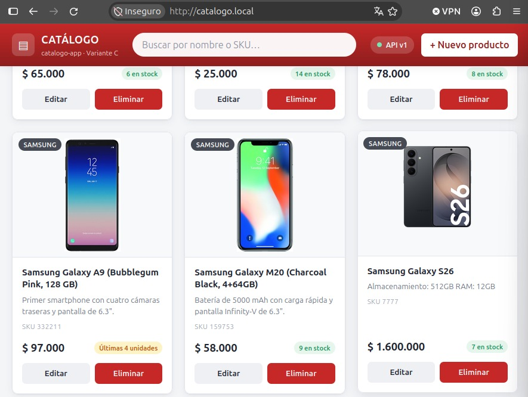
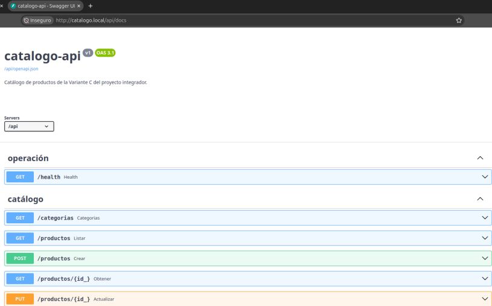
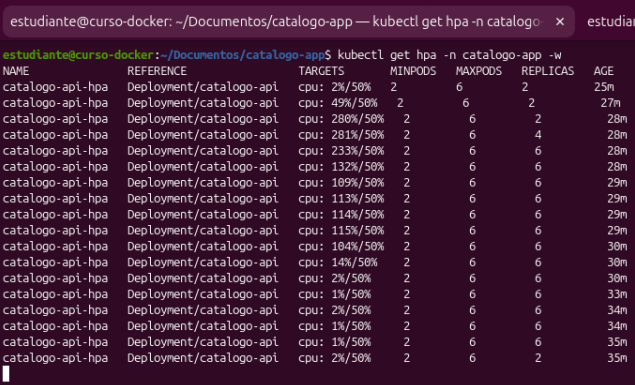
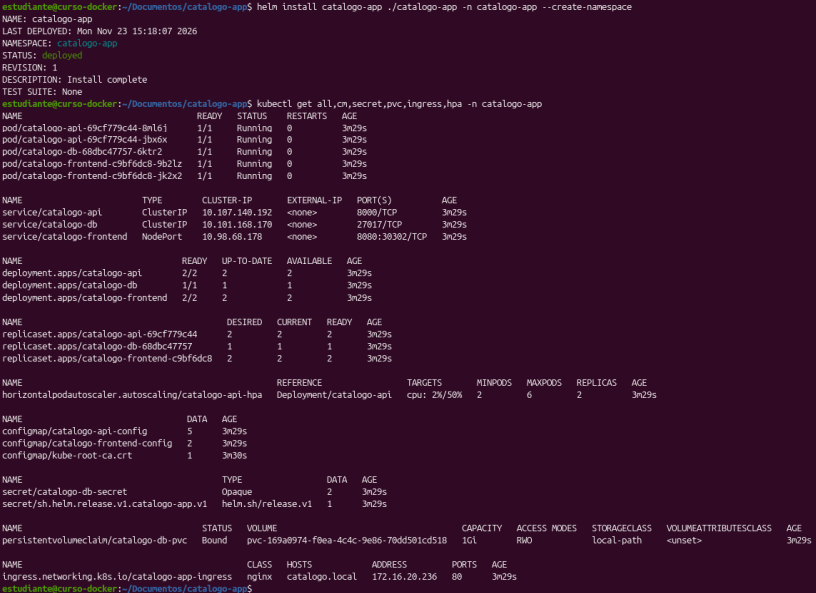
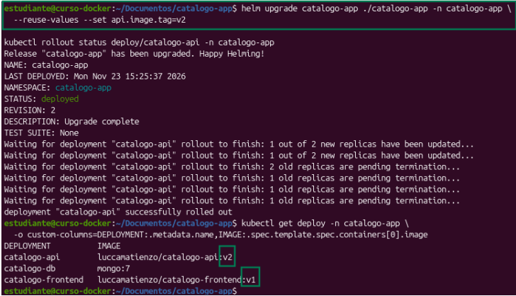
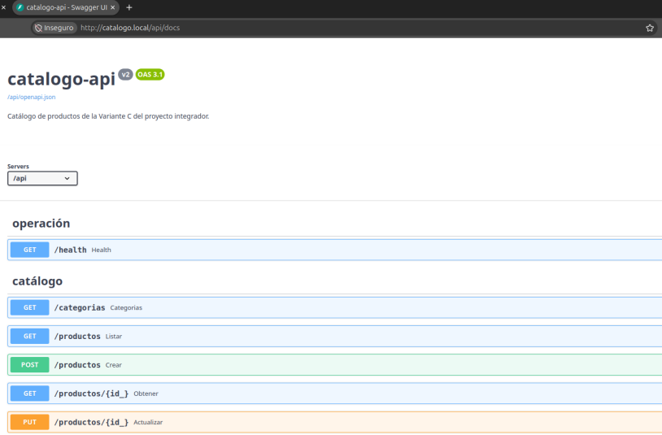
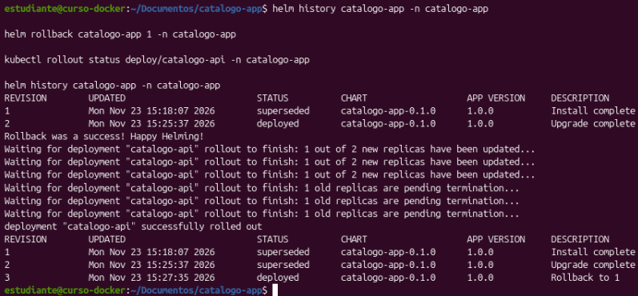
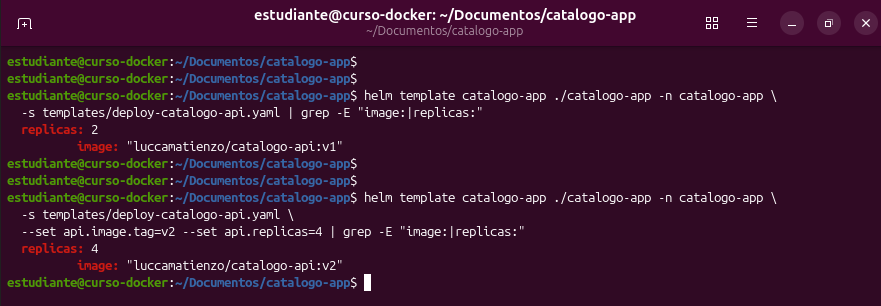
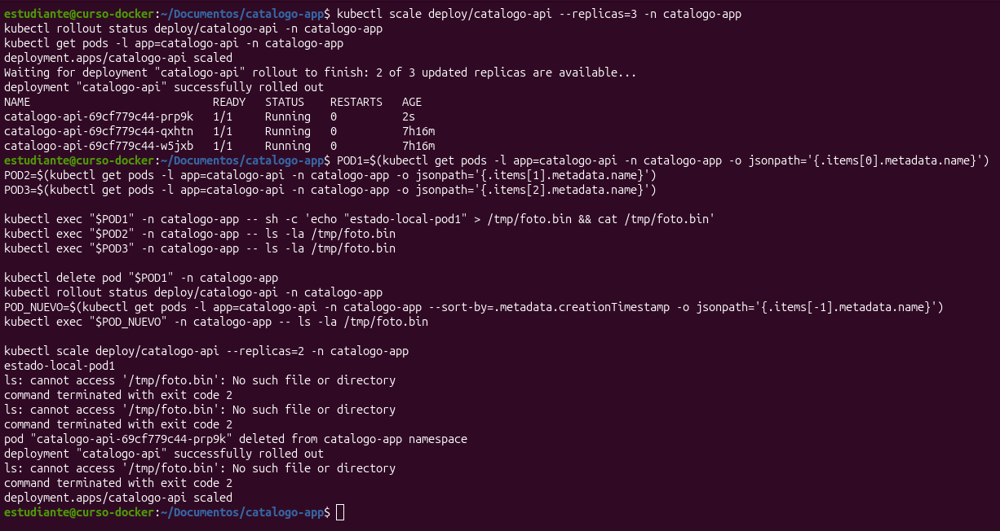

# Informe de Funcionamiento — `catalogo-app` (Variante C)

Este informe documenta con capturas y registros de comandos reales la operación del despliegue completo de `catalogo-app` (12 objetos empaquetados en el chart de Helm `catalogo-app/`).

---

## 1. Aplicación respondiendo a través del Ingress con producto cargado manualmente e imagen

Se verificó la exposición HTTP mediante `catalogo-app-ingress` (`host: catalogo.local`, apuntando a `172.16.20.236` en `/etc/hosts` con regla única `/` hacia `catalogo-frontend:8080`). Desde el navegador se cargó manualmente el producto **Samsung Galaxy S26** (SKU `7777`, `$ 1.600.000`, `7 en stock`) adjuntando su imagen, comprobando tanto su persistencia en MongoDB (`catalogo-db-pvc`) como el correcto funcionamiento del proxy reverso de Nginx y del indicador de versión `API v1`.



Adicionalmente se comprobó el funcionamiento de la documentación interactiva detrás del Ingress (`http://catalogo.local/api/docs`), confirmando que `ROOT_PATH=/api` llega efectivamente desde `catalogo-api-config` y resuelve `/api/openapi.json` en versión `v1`:



Comandos de verificación del Ingress y de la especificación OpenAPI detrás del proxy:

```bash
$ kubectl get ingress -n catalogo-app
NAME                   CLASS   HOSTS            ADDRESS         PORTS   AGE
catalogo-app-ingress   nginx   catalogo.local   172.16.20.236   80      19s

$ curl -s [http://catalogo.local/api/docs](http://catalogo.local/api/docs) | grep -i openapi
        url: '/api/openapi.json',

$ curl -s -o /dev/null -w "%{http_code}\n" [http://catalogo.local/api/openapi.json](http://catalogo.local/api/openapi.json)
200
```

**Qué se observa:** el Ingress recibe la dirección `172.16.20.236` del controlador `nginx-ingress-controller`, la SPA renderiza el producto cargado a mano con su imagen almacenada en MongoDB y Swagger UI carga completamente con código `200` sobre `/api/openapi.json` gracias a `ROOT_PATH=/api`.

---

## 2. Escalado automático bajo carga real (`kubectl get hpa -w`)

Con `resources.requests.cpu: 100m` declarado en `catalogo-api` y `catalogo-api-hpa` configurado con `minReplicas: 2`, `maxReplicas: 6` y objetivo `averageUtilization: 50%`, se generó carga sostenida contra la API y se registró el ciclo completo de subida y bajada:

```bash
$ kubectl get hpa -n catalogo-app -w
NAME               REFERENCE                 TARGETS          MINPODS   MAXPODS   REPLICAS   AGE
catalogo-api-hpa   Deployment/catalogo-api   cpu: 2%/50%      2         6         2          25m
catalogo-api-hpa   Deployment/catalogo-api   cpu: 49%/50%     2         6         2          27m
catalogo-api-hpa   Deployment/catalogo-api   cpu: 280%/50%    2         6         2          28m
catalogo-api-hpa   Deployment/catalogo-api   cpu: 281%/50%    2         6         4          28m
catalogo-api-hpa   Deployment/catalogo-api   cpu: 233%/50%    2         6         6          28m
catalogo-api-hpa   Deployment/catalogo-api   cpu: 132%/50%    2         6         6          28m
catalogo-api-hpa   Deployment/catalogo-api   cpu: 109%/50%    2         6         6          29m
catalogo-api-hpa   Deployment/catalogo-api   cpu: 113%/50%    2         6         6          29m
catalogo-api-hpa   Deployment/catalogo-api   cpu: 114%/50%    2         6         6          29m
catalogo-api-hpa   Deployment/catalogo-api   cpu: 115%/50%    2         6         6          29m
catalogo-api-hpa   Deployment/catalogo-api   cpu: 104%/50%    2         6         6          30m
catalogo-api-hpa   Deployment/catalogo-api   cpu: 14%/50%     2         6         6          30m
catalogo-api-hpa   Deployment/catalogo-api   cpu: 2%/50%      2         6         6          30m
catalogo-api-hpa   Deployment/catalogo-api   cpu: 1%/50%      2         6         6          33m
catalogo-api-hpa   Deployment/catalogo-api   cpu: 2%/50%      2         6         6          34m
catalogo-api-hpa   Deployment/catalogo-api   cpu: 1%/50%      2         6         6          34m
catalogo-api-hpa   Deployment/catalogo-api   cpu: 1%/50%      2         6         6          35m
catalogo-api-hpa   Deployment/catalogo-api   cpu: 2%/50%      2         6         2          35m
```



**Qué se observa:** al inyectar carga, el consumo supera el umbral del 50% (alcanzando un pico de `281%/50%`) y el HPA escala `catalogo-api` de `2` a `4` y luego al tope de `6` réplicas (minuto `28m`). Al detener la carga (`30m`), la CPU cae a `1%–2%`, pero el controlador respeta la ventana de estabilización de bajada de 5 minutos antes de reducir nuevamente de `6` a `2` réplicas en el minuto `35m`.

---

## 3. Ciclo completo de release en Helm (`install`, `upgrade`, `history` y `rollback`)

### Instalación inicial (Revisión 1 — `v1`)
Se instaló el chart `catalogo-app/` creando el namespace `catalogo-app` y se verificó el estado operativo de los 12 objetos declarados (Pods `Running`, PVC en `Bound`, Ingress con `ADDRESS: 172.16.20.236` y HPA informando porcentaje numérico):



### Actualización a `v2` (`helm upgrade`) y reversión (`helm rollback`)
Se actualizó únicamente la imagen de la API a `v2` con `helm upgrade --reuse-values --set api.image.tag=v2` (Revisión 2) y posteriormente se revirtió a la Revisión 1 mediante `helm rollback` (Revisión 3):

```bash
$ helm upgrade catalogo-app ./catalogo-app -n catalogo-app \
  --reuse-values --set api.image.tag=v2
Release "catalogo-app" has been upgraded. Happy Helming!
NAME: catalogo-app
LAST DEPLOYED: Mon Nov 23 15:25:37 2026
NAMESPACE: catalogo-app
STATUS: deployed
REVISION: 2
DESCRIPTION: Upgrade complete

$ kubectl get deploy -n catalogo-app \
  -o custom-columns=DEPLOYMENT:.metadata.name,IMAGE:.spec.template.spec.containers[0].image
DEPLOYMENT          IMAGE
catalogo-api        luccamatienzo/catalogo-api:v2
catalogo-db         mongo:7
catalogo-frontend   luccamatienzo/catalogo-frontend:v1

$ helm history catalogo-app -n catalogo-app
REVISION   UPDATED                    STATUS       CHART                APP VERSION   DESCRIPTION
1          Mon Nov 23 15:18:07 2026   superseded   catalogo-app-0.1.0   1.0.0         Install complete
2          Mon Nov 23 15:25:37 2026   deployed     catalogo-app-0.1.0   1.0.0         Upgrade complete

$ helm rollback catalogo-app 1 -n catalogo-app
Rollback was a success! Happy Helming!

$ helm history catalogo-app -n catalogo-app
REVISION   UPDATED                    STATUS       CHART                APP VERSION   DESCRIPTION
1          Mon Nov 23 15:18:07 2026   superseded   catalogo-app-0.1.0   1.0.0         Install complete
2          Mon Nov 23 15:25:37 2026   superseded   catalogo-app-0.1.0   1.0.0         Upgrade complete
3          Mon Nov 23 15:27:35 2026   deployed     catalogo-app-0.1.0   1.0.0         Rollback to 1
```







**Qué se observa:** el historial registra las tres revisiones (`Install complete`, `Upgrade complete` y `Rollback to 1`, donde revertir genera la Revisión 3 en estado `deployed`). Además, la salida de `kubectl get deploy` y las capturas del navegador verifican que actualizar `api.image.tag` a `v2` no alteró `catalogo-frontend`, que continuó ejecutando `v1` por tratarse de imágenes con ciclos de vida independientes.

---

## 4. Prueba de parametrización efectiva en `values.yaml` (no decorativa)

Se renderizó dos veces la misma plantilla (`templates/deploy-catalogo-api.yaml`) con `helm template`: primero usando los valores por defecto de `values.yaml` y luego sobrescribiendo `api.image.tag` y `api.replicas` mediante `--set`:

```bash
$ helm template catalogo-app ./catalogo-app -n catalogo-app \
  -s templates/deploy-catalogo-api.yaml | grep -E "image:|replicas:"
  replicas: 2
          image: "luccamatienzo/catalogo-api:v1"

$ helm template catalogo-app ./catalogo-app -n catalogo-app \
  -s templates/deploy-catalogo-api.yaml \
  --set api.image.tag=v2 --set api.replicas=4 | grep -E "image:|replicas:"
  replicas: 4
          image: "luccamatienzo/catalogo-api:v2"
```



**Qué se observa:** al modificar los parámetros mediante `--set`, el manifiesto generado refleja de forma inmediata tanto el cambio de réplicas (`2` -> `4`) como el tag de imagen (`v1` -> `v2`), demostrando que las claves de `values.yaml` gobiernan efectivamente las plantillas. Asimismo, el renderizado completo del chart genera exactamente los 12 objetos esperados (`helm template catalogo-app ./catalogo-app -n catalogo-app | grep -c "^kind:"` devuelve `12`).

---

## 5. Prueba de estado efímero y aislamiento del filesystem entre réplicas (respaldo a la Pregunta 2 de `ARQUITECTURA.md`)

Se escaló `catalogo-api` a 3 réplicas, se creó `/tmp/foto.bin` dentro del primer Pod (`catalogo-api-69cf779c44-prp9k`), se consultó desde las otras dos réplicas (`qxhtn` y `w5jxb`), se eliminó el primer Pod y se verificó en el Pod recreado por el `ReplicaSet`:

```bash
$ kubectl scale deploy/catalogo-api --replicas=3 -n catalogo-app
deployment.apps/catalogo-api scaled

$ kubectl get pods -l app=catalogo-api -n catalogo-app
NAME                            READY   STATUS    RESTARTS   AGE
catalogo-api-69cf779c44-prp9k   1/1     Running   0          2s
catalogo-api-69cf779c44-qxhtn   1/1     Running   0          7h16m
catalogo-api-69cf779c44-w5jxb   1/1     Running   0          7h16m

$ kubectl exec "$POD1" -n catalogo-app -- sh -c 'echo "estado-local-pod1" > /tmp/foto.bin && cat /tmp/foto.bin'
estado-local-pod1

$ kubectl exec "$POD2" -n catalogo-app -- ls -la /tmp/foto.bin
ls: cannot access '/tmp/foto.bin': No such file or directory
command terminated with exit code 2

$ kubectl exec "$POD3" -n catalogo-app -- ls -la /tmp/foto.bin
ls: cannot access '/tmp/foto.bin': No such file or directory
command terminated with exit code 2

$ kubectl delete pod "$POD1" -n catalogo-app
pod "catalogo-api-69cf779c44-prp9k" deleted from catalogo-app namespace

$ kubectl exec "$POD_NUEVO" -n catalogo-app -- ls -la /tmp/foto.bin
ls: cannot access '/tmp/foto.bin': No such file or directory
command terminated with exit code 2
```



**Qué se observa:** el archivo `/tmp/foto.bin` escrito en la primera réplica es completamente invisible para las otras dos réplicas (`No such file or directory`) y desaparece de forma definitiva cuando ese Pod es eliminado y reemplazado por el `ReplicaSet`. Esto demuestra por qué `catalogo-api` no guarda archivos ni sesiones en el contenedor y delega el almacenamiento de las imágenes del catálogo a MongoDB.
